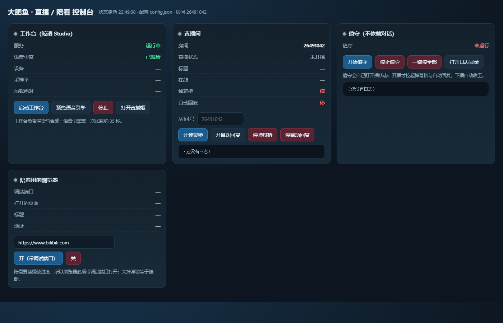
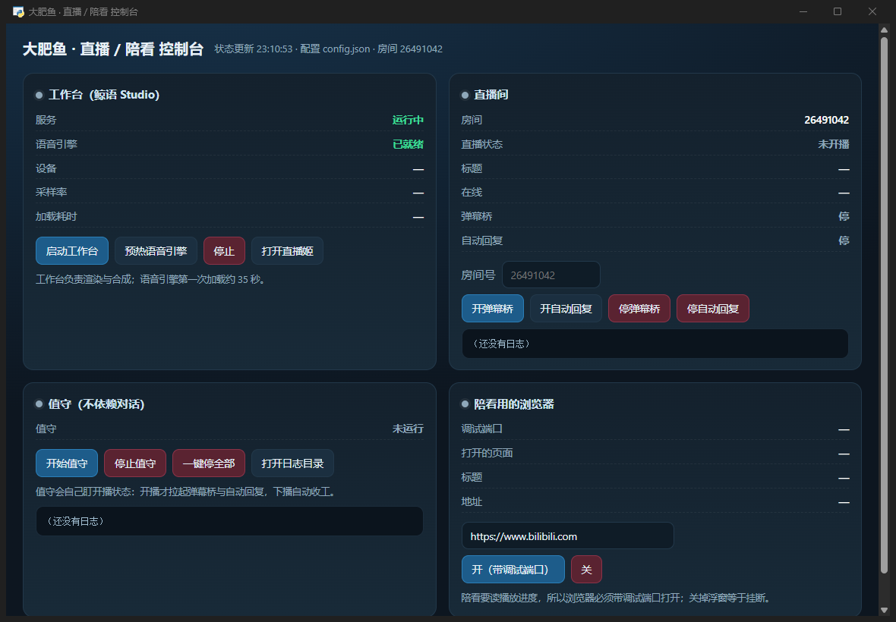

# 大肥鱼 · 直播 / 陪看 控制台

把「让 Live2D 角色开口说话、回弹幕、陪人看视频」这一堆散落的脚本，收成一块能**点按钮开关**的本地面板。

界面只有一个网页，后端是单个 `app.py`，**不依赖任何第三方库**（Python 3.10+ 自带的东西就够）。



## 它管什么

| 卡片 | 能做的事 |
|---|---|
| 工作台（鲸语 Studio） | 启动 / 停止渲染与合成服务、预热语音引擎、顺手拉起直播姬 |
| 直播间 | 开 / 停**真实弹幕桥**（只读接收，从不往 B 站写）、开 / 停**自动回复**（弹幕 → LLM → 语音 → 口型） |
| 值守 | 一键挂机：自己盯开播状态，开播才拉起弹幕桥与自动回复，下播自动收工 |
| 陪看用的浏览器 | 开一个**带调试端口**的浏览器（陪看要读播放进度）、关掉它 |

状态每 2 秒刷新：服务在不在、语音引擎 ready 没、直播间开没开播、各进程跑没跑、日志尾巴。

## 它不管什么（重要）

这是一个**编排层**，不是把功能重写一遍。真正干活的东西必须在别处自己装好：

- **渲染 / 合成 / 口型**：鲸语 Agent-Live2D 桥接工作台（`launch.py`），也就是本面板里的「工作台」。
- **语音**：工作台那侧的 TTS 引擎（本项目自带的是接「肥鱼声库」的路径，换成你自己的合成器也能跑）。
- **弹幕桥 / 自动回复 / 值守**：`bili_live_bridge.py`、`auto_reply.py`、`live_host.py` 三个脚本，通过 `config.json` 指过去。
- **陪看**本身是 DSH 的 `dsh-watch-together` 插件，本面板只负责把「能读到播放进度」的浏览器开出来；浮窗、台词、挂断都在 DSH 那边。

所以：**没有模型、没有工作台、没有 DSH，这个面板只会显示一堆「未启动」**——这不是坏了。

## 双击就能开（桌面窗口）

不想开浏览器、也不想点 bat 的话，用 `desktop.py`：

```bash
python -m pip install pywebview      # 只用一次
pythonw desktop.py                   # 无控制台窗口，直接出窗口
```

它会自己把 `app.py` 拉起来，然后用系统自带的 WebView2 开一个**原生窗口**（没有地址栏、没有标签页、关窗即收工）：



- 没装 `pywebview` 也不会崩：会退化成用 Edge/Chrome 的 `--app=…` 模式，外观同样是独立窗口，只是任务栏图标是浏览器的。
- 想做个**桌面快捷方式**：目标填 `pythonw.exe`，参数填 `"<本目录>\desktop.py"`，起始位置填本目录，图标用 `docs/app.ico`。

### 已经打好的 exe

[Releases](https://github.com/HT0w0/l2d-console/releases) 里有 `L2DConsole.exe`（单文件，约 12 MB，双击即用，目标机器**不需要装 Python**）。
把它放到任意目录，旁边放一份 `config.json`（照 `config.example.json` 改），双击即可。

自己打：
```bash
pip install pyinstaller
pyinstaller --noconsole --onefile --icon "docs/app.ico" --name L2DConsole ^
  --add-data "ui.html;." --add-data "config.example.json;." --add-data "docs/app.ico;docs" ^
  --hidden-import app --hidden-import webview.platforms.edgechromium desktop.py
```

（`--add-data` 的 Windows 分隔符是分号；`--hidden-import app` 必须加，因为 `desktop.py` 是动态 import 的，PyInstaller 扫不到。）

## 快速开始

```bash
git clone https://github.com/HT0w0/l2d-console.git
cd l2d-console
copy config.example.json config.json     # 然后改里面的路径和房间号
python app.py --open                     # 打开 http://127.0.0.1:61950
```

Windows 上也可以直接双击 `启动控制台.bat`。

## 配置

`config.json`（不进版本库，照 `config.example.json` 抄一份）：

| 字段 | 说明 |
|---|---|
| `python` | 跑这些脚本用的解释器 |
| `workbench_dir` | 鲸语工作台目录（里面有 `launch.py`） |
| `voice_dir` | 三个脚本所在目录（`bili_live_bridge.py` 等） |
| `room_id` | 你的直播间号（自己去 B 站直播间 URL 里看） |
| `console_port` | 本面板端口，默认 61950 |
| `workbench_port` | 工作台端口，默认 61942 |
| `browser_debug_port` | 陪看浏览器调试端口，默认 9333 |
| `browser_candidates` / `livehime_candidates` | 按顺序找，第一个存在的就用 |

## 一些实现上的坑（踩过，写下来省你一份）

- **不能靠命令行字符串判断"某个脚本还在跑"**：`Get-CimInstance ... Where CommandLine -like '*live_host.py*'` 会把**查询自己的那个 powershell** 也匹配上，于是永远显示"运行中"。这里限定进程名 `python.exe / pythonw.exe` 再匹配。
- **JSON 配置不要写 BOM**：上游插件 `JSON.parse` 会直接失败，然后安静地当成"没配置"。本项目的 `config.json` 用 UTF-8 无 BOM 写。
- **`.bat` 里别放中文**：cmd 按本地代码页解析 UTF-8 批处理会把中文行拆成命令。所以启动脚本全 ASCII。
- **浏览器 `--user-data-dir` 不要用中文路径**，Chromium 会拒绝带调试端口启动；这里统一放 `%LOCALAPPDATA%\dsh-edge-watch`。
- **`--remote-debugging-port` 只在非默认数据目录下才生效**（Chromium 136+ 的限制），所以陪看浏览器一定用独立 profile。

## 许可

代码 MIT。**不含**任何 Live2D 模型、贴图、PSD 或工作台本体——那些各有各的作者和授权，请去原作者处获取并遵守其条款。本项目也不与 B 站、Live2D Inc.、VTube Studio 存在隶属关系。

## 声明

弹幕桥只做**接收**，不发送、不点赞、不关注；请只连自己的直播间。
